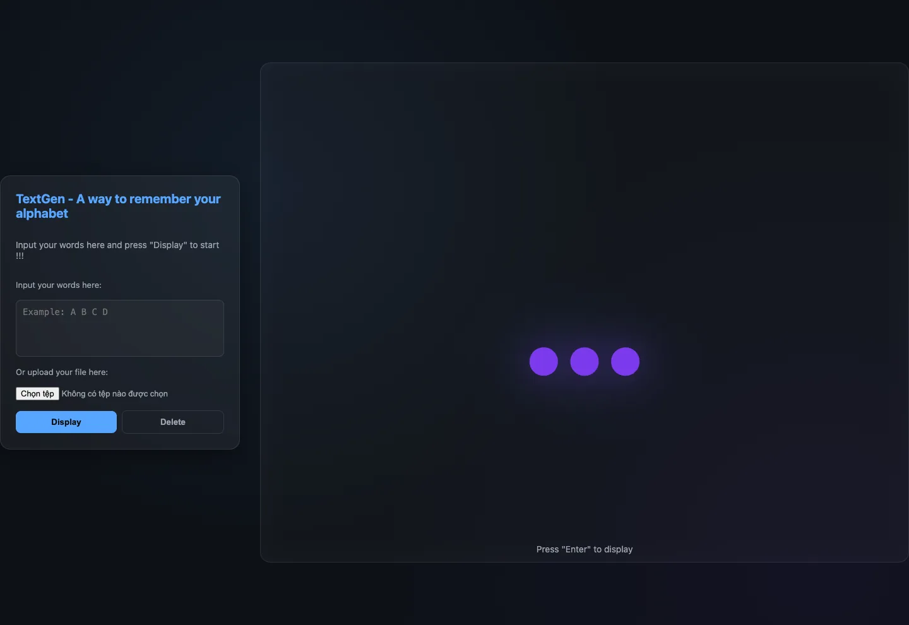
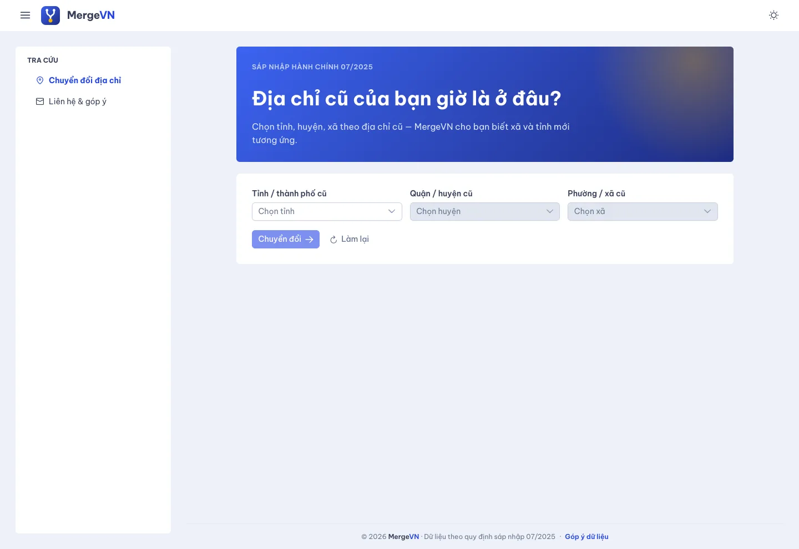
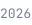
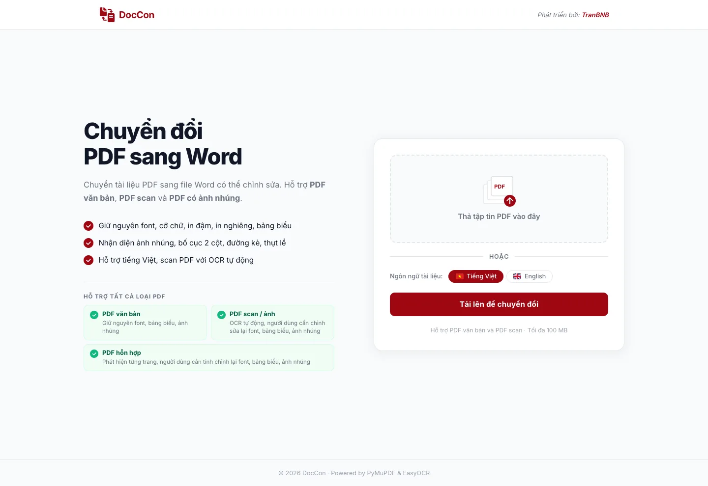
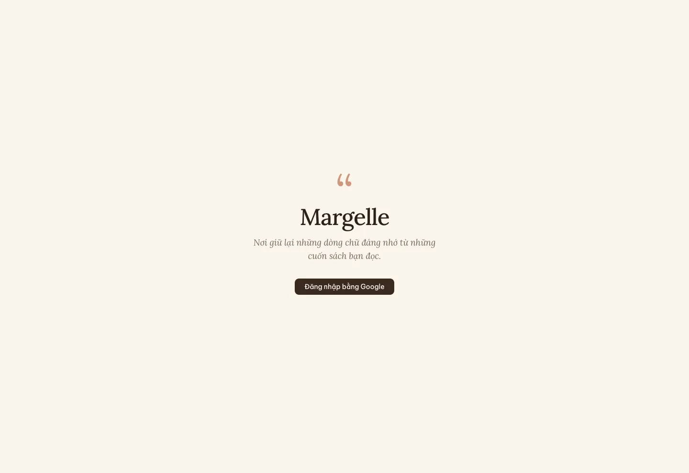
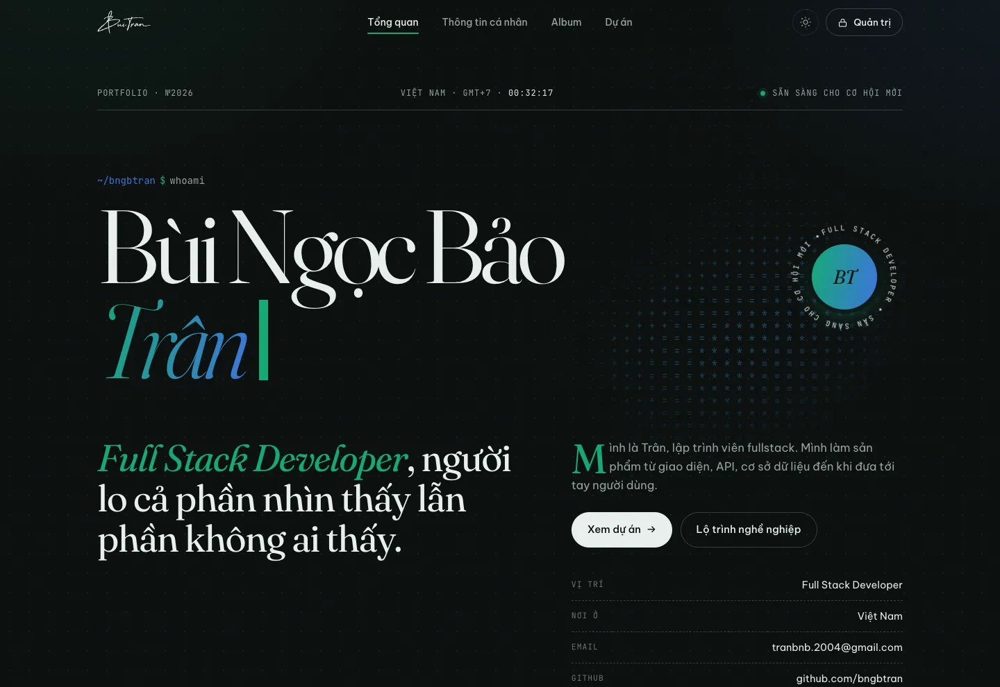
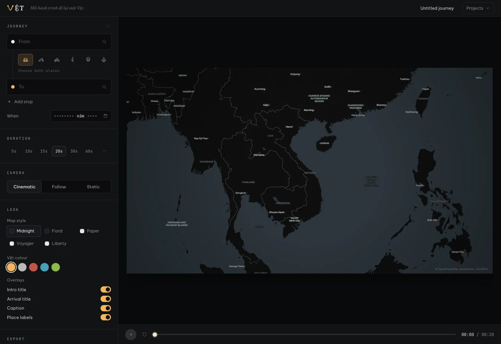
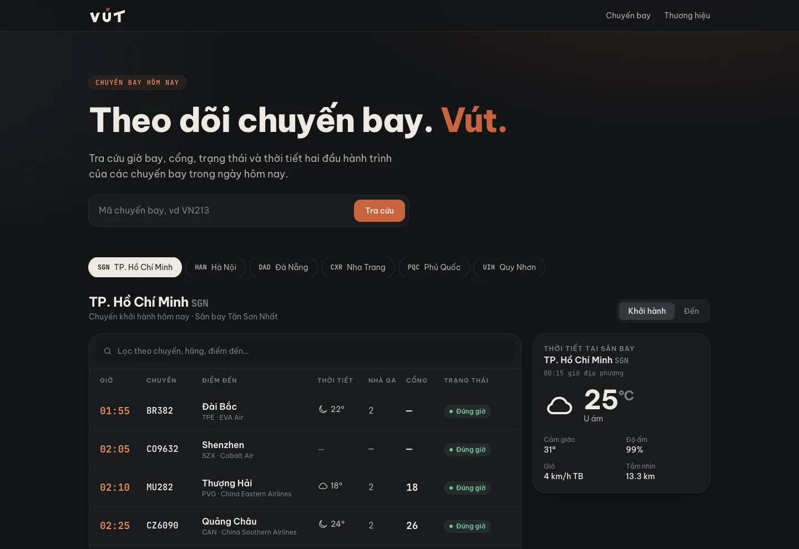

<!-- Tệp này được GitHub Actions tự dựng từ dữ liệu portfolio. Đừng sửa tay: thay đổi sẽ bị ghi đè. -->

<picture>
  <source media="(prefers-color-scheme: dark)" srcset="images/readme/hero-dark.svg" />
  
</picture>

Mình là Trân, lập trình viên fullstack. Mình làm sản phẩm từ giao diện, API, cơ sở dữ liệu đến khi đưa tới tay người dùng.

Từ học sinh chuyên Văn đến lập trình viên, mình tập trung làm công nghệ hướng tới con người.

**[Portfolio ↗](https://bngbtran.vercel.app)** &nbsp;·&nbsp; **[Email ↗](mailto:tranbnb.2004@gmail.com)**

<picture>
  <source media="(prefers-color-scheme: dark)" srcset="images/readme/stats-dark.svg" />
  
</picture>

<picture>
  <source media="(prefers-color-scheme: dark)" srcset="images/readme/h-projects-dark.svg" />
  
</picture>

**Sản phẩm** · 8 dự án

<table><tr><td width="50%" valign="top"><h3>TextGen</h3>
Công cụ nhỏ giúp ghi nhớ bảng chữ cái: nhập từ hoặc tải file lên, trang sẽ hiển thị từng chữ để luyện.

<code>HTML</code> <code>CSS</code> <code>JavaScript</code>

<a href="https://bngbtran.github.io/TextGen/">Website ↗</a> · <a href="https://github.com/bngbtran/TextGen">Mã nguồn ↗</a>
</td><td width="50%" valign="top"><h3>MergeVN</h3>
Chuyển địa chỉ hành chính cũ sang địa chỉ mới sau đợt sáp nhập 07/2025, tra cứu theo tỉnh, huyện, xã. Dữ liệu chỉ nằm phía server, có thêm app Android.

<code>Vue 3</code> <code>Vite</code> <code>PrimeVue</code> <code>Tailwind CSS</code> <code>Vercel Functions</code> <code>Kotlin</code>

<a href="https://bngbtran-mergevn.vercel.app">Website ↗</a> · <a href="https://github.com/bngbtran/MergeVN">Mã nguồn ↗</a>
</td></tr><tr><td width="50%" valign="top"><h3>Window Music Player</h3>
Ứng dụng nghe nhạc WPF cho Windows: tự tạo playlist theo thư mục, hỗ trợ phím media toàn cục và chế độ Focus đếm giờ làm việc.

<code>C#</code> <code>WPF</code> <code>.NET 8</code>

<a href="https://github.com/bngbtran/Window-Music-Player">Mã nguồn ↗</a>
</td><td width="50%" valign="top"><h3>DocCon</h3>
Chuyển PDF sang Word, giữ font, bảng biểu và bố cục. Hỗ trợ cả PDF văn bản, PDF scan và PDF hỗn hợp nhờ OCR.

<code>React</code> <code>Vite</code> <code>FastAPI</code> <code>PyMuPDF</code> <code>EasyOCR</code> <code>Docker</code>

<a href="https://bngbtran-doccon.vercel.app">Website ↗</a> · <a href="https://github.com/bngbtran/DocCon">Mã nguồn ↗</a>
</td></tr><tr><td width="50%" valign="top"><h3>Margelle</h3>
Kệ sách trích dẫn dùng chung: mỗi playlist là một cuốn sách trên kệ, mỗi trích dẫn là một trang, chân trang ghi tên người đóng góp.

<code>React</code> <code>Vite</code> <code>Tailwind CSS</code> <code>shadcn/ui</code> <code>Firebase</code>

<a href="https://bngbtran-margelle.vercel.app">Website ↗</a> · <a href="https://github.com/bngbtran/Margelle">Mã nguồn ↗</a>
</td><td width="50%" valign="top"><h3>Portfolio cá nhân</h3>
Chính là trang này: site tĩnh không dùng framework, có trang quản trị sửa ngay trên giao diện và cập nhật realtime, kèm app Android.

<code>HTML</code> <code>CSS</code> <code>JavaScript</code> <code>Firebase</code> <code>Cloudinary</code>

<a href="https://bngbtran.vercel.app">Website ↗</a> · <a href="https://github.com/bngbtran/bngbtran">Mã nguồn ↗</a>
</td></tr><tr><td width="50%" valign="top"><h3>Vệt</h3>
Biến một hành trình thành video lộ trình động trên bản đồ, xuất video ngay trong trình duyệt, không cần backend hay tài khoản.

<code>React</code> <code>TypeScript</code> <code>MapLibre GL</code> <code>WebCodecs</code>

<a href="https://bngbtran-vet.vercel.app">Website ↗</a> · <a href="https://github.com/bngbtran/VET">Mã nguồn ↗</a>
</td><td width="50%" valign="top"><h3>VÚT</h3>
Theo dõi chuyến bay trong ngày: giờ bay, cổng, trạng thái và thời tiết ở hai đầu hành trình.

<code>Next.js</code> <code>TypeScript</code> <code>Tailwind CSS</code> <code>Upstash Redis</code>

<a href="https://bngbtran-vut.vercel.app">Website ↗</a> · <a href="https://github.com/bngbtran/VUT">Mã nguồn ↗</a>
</td></tr></table>

**Học tập** · 58 môn

<b>FPT University</b> · 46 môn · Cử nhân Kỹ thuật Phần mềm, 2021 — 2025.

<table><tr><td valign="top"><a href="https://github.com/bngbtran/PRN211"><b>PRN211</b></a></td><td><b>Lập trình C# cơ bản</b> Assignment, lab và bài thi thực hành với C#.</td><td valign="top"><code>C#</code></td></tr><tr><td valign="top"><a href="https://github.com/bngbtran/PRN221"><b>PRN221</b></a></td><td><b>Lập trình .NET nâng cao</b> Assignment, lab, bài thi và dự án môn học trên .NET.</td><td valign="top"><code>C#</code></td></tr><tr><td valign="top"><a href="https://github.com/bngbtran/EXE101"><b>EXE101</b></a></td><td><b>Khởi nghiệp trải nghiệm</b> NiceHouse, sản phẩm thử nghiệm viết bằng C#.</td><td valign="top"><code>C#</code></td></tr><tr><td valign="top"><a href="https://github.com/bngbtran/SWP391"><b>SWP391</b></a></td><td><b>Đồ án phát triển phần mềm</b> Đồ án nhóm FITM, làm trọn quy trình phát triển phần mềm.</td><td valign="top"><code>C#</code></td></tr><tr><td valign="top"><a href="https://github.com/bngbtran/PRU212"><b>PRU212</b></a></td><td><b>Lập trình game với Unity</b> Dự án môn học viết bằng C#.</td><td valign="top"><code>C#</code></td></tr><tr><td valign="top"><a href="https://github.com/bngbtran/OJT202"><b>OJT202</b></a></td><td><b>Thực tập doanh nghiệp (OJT)</b> Ghi chú và bài luyện frontend trong kỳ OJT, gồm FER201m và Vue.js.</td><td valign="top"><code>HTML</code></td></tr><tr><td valign="top"><a href="https://github.com/bngbtran/PRF192"><b>PRF192</b></a></td><td><b>Nhập môn lập trình</b> Các workshop và bài thi thực hành, nơi viết những dòng code đầu tiên.</td><td valign="top"><code>C++</code></td></tr><tr><td valign="top"><a href="https://github.com/bngbtran/PRO192"><b>PRO192</b></a></td><td><b>Lập trình hướng đối tượng với Java</b> Các ứng dụng quản lý nhỏ: ngân hàng, khách sạn, thư viện, nhân viên.</td><td valign="top"><code>Java</code></td></tr><tr><td valign="top"><a href="https://github.com/bngbtran/PRJ301"><b>PRJ301</b></a></td><td><b>Lập trình web với Java</b> Giao diện JSP và các ứng dụng Servlet.</td><td valign="top"><code>Java</code></td></tr><tr><td valign="top"><a href="https://github.com/bngbtran/LAB211"><b>LAB211</b></a></td><td><b>Thực hành Java</b> Quản lý sách, đĩa CD và sản phẩm.</td><td valign="top"><code>Java</code></td></tr><tr><td valign="top"><a href="https://github.com/bngbtran/CSD201"><b>CSD201</b></a></td><td><b>Cấu trúc dữ liệu và giải thuật</b> Linked list, stack, queue, đồ thị, biểu thức và cây BST.</td><td valign="top"><code>Java</code></td></tr><tr><td valign="top"><a href="https://github.com/bngbtran/CEA201"><b>CEA201</b></a></td><td><b>Kiến trúc máy tính</b> Chín bài tập lập trình Assembly.</td><td valign="top"><code>Assembly</code></td></tr><tr><td valign="top"><a href="https://github.com/bngbtran/SEP490"><b>SEP490</b></a></td><td><b>Đồ án tốt nghiệp</b> SmartMenu: thực đơn thông minh dùng AI nhận diện khuôn mặt để gợi ý món, gồm backend, web và app mobile.</td><td valign="top"><code>C#</code></td></tr><tr><td valign="top"><a href="https://github.com/bngbtran/PRN231"><b>PRN231</b></a></td><td><b>Xây dựng backend với .NET</b> Assignment, lab, bài thi và dự án môn học.</td><td valign="top"><code>C#</code></td></tr><tr><td valign="top"><a href="https://github.com/bngbtran/PRM392"><b>PRM392</b></a></td><td><b>Lập trình Android</b> Ứng dụng Android xây dựng bằng Gradle.</td><td valign="top"><code>Java</code></td></tr><tr><td valign="top"><a href="https://github.com/bngbtran/NLP301c"><b>NLP301c</b></a></td><td><b>Xử lý ngôn ngữ tự nhiên</b> Bài tập notebook của chuỗi bốn khóa học NLP.</td><td valign="top"><code>Jupyter Notebook</code></td></tr><tr><td valign="top"><a href="https://github.com/bngbtran/AID301c"><b>AID301c</b></a></td><td><b>Phát triển ứng dụng AI</b> Notebook code theo khóa học trực tuyến.</td><td valign="top"><code>Jupyter Notebook</code></td></tr><tr><td valign="top"><a href="https://github.com/bngbtran/MLI101"><b>MLI101</b></a></td><td><b>Giáo dục Quốc phòng</b> Bài luận trong môn Quốc phòng bắt buộc của sinh viên Đại học.</td><td valign="top"></td></tr><tr><td valign="top"><a href="https://github.com/bngbtran/CSI104"><b>CSI104</b></a></td><td><b>Giới thiệu về Khoa học máy tính</b> Làm quen với phần cứng máy tính</td><td valign="top"></td></tr><tr><td valign="top"><a href="https://github.com/bngbtran/ENT"><b>ENT</b></a></td><td><b>Tiếng Anh đầu vào</b> Các mức tiếng Anh dự bị trước khi bắt đầu học chuyên ngành.</td><td valign="top"></td></tr><tr><td valign="top"><a href="https://github.com/bngbtran/MAE101"><b>MAE101</b></a></td><td><b>Toán cho kỹ thuật</b> Hai bài assignment của môn học.</td><td valign="top"></td></tr><tr><td valign="top"><a href="https://github.com/bngbtran/OSG202"><b>OSG202</b></a></td><td><b>Hệ điều hành</b> Bốn bài lab có hướng dẫn, bài thuyết trình và bài làm lý thuyết theo từng chương.</td><td valign="top"></td></tr><tr><td valign="top"><a href="https://github.com/bngbtran/NWC203c"><b>NWC203c</b></a></td><td><b>Mạng máy tính</b> Bốn khóa Coursera về truyền thông mạng, mạng LAN, chuyển mạch gói và TCP/IP.</td><td valign="top"></td></tr><tr><td valign="top"><a href="https://github.com/bngbtran/MAD101"><b>MAD101</b></a></td><td><b>Toán rời rạc</b> Bảy assignment, bốn computer project và ba bài progress test.</td><td valign="top"></td></tr><tr><td valign="top"><a href="https://github.com/bngbtran/SSL101c"><b>SSL101c</b></a></td><td><b>Kỹ năng học tập đại học</b> Năm khóa Coursera về kỹ năng số, giải quyết vấn đề, tư duy phản biện và giao tiếp.</td><td valign="top"></td></tr><tr><td valign="top"><a href="https://github.com/bngbtran/SSG104"><b>SSG104</b></a></td><td><b>Kỹ năng giao tiếp và cộng tác</b> Bài luận, bài thuyết trình và báo cáo dự án kinh doanh nhóm.</td><td valign="top"></td></tr><tr><td valign="top"><a href="https://github.com/bngbtran/DBI202"><b>DBI202</b></a></td><td><b>Cơ sở dữ liệu</b> Các bài lab, script SQL và dự án môn học với SQL Server.</td><td valign="top"><code>TSQL</code></td></tr><tr><td valign="top"><a href="https://github.com/bngbtran/IOT102"><b>IOT102</b></a></td><td><b>Internet vạn vật</b> Các bài lab với cảm biến, servo, LED 7 đoạn và LCD, kèm dự án mô phỏng trên Tinkercad.</td><td valign="top"></td></tr><tr><td valign="top"><a href="https://github.com/bngbtran/WED201c"><b>WED201c</b></a></td><td><b>Thiết kế web</b> Năm khóa Coursera về HTML5, CSS3, JavaScript và responsive design.</td><td valign="top"></td></tr><tr><td valign="top"><a href="https://github.com/bngbtran/SWE201c"><b>SWE201c</b></a></td><td><b>Nhập môn Kỹ thuật phần mềm</b> Bốn khóa Coursera về quy trình phát triển, Agile, Lean và chất lượng phần mềm.</td><td valign="top"></td></tr><tr><td valign="top"><a href="https://github.com/bngbtran/MAS291"><b>MAS291</b></a></td><td><b>Xác suất thống kê</b> Hai bài assignment và computer project làm theo nhóm.</td><td valign="top"></td></tr><tr><td valign="top"><a href="https://github.com/bngbtran/JPD123"><b>JPD123</b></a></td><td><b>Tiếng Nhật sơ cấp 2</b> Chín bài kiểm tra, bốn bài hội thoại và bài tự giới thiệu.</td><td valign="top"></td></tr><tr><td valign="top"><a href="https://github.com/bngbtran/JPD113"><b>JPD113</b></a></td><td><b>Tiếng Nhật sơ cấp 1</b> Sáu bài kiểm tra, ba bài hội thoại và bản dịch giáo trình Dekiru.</td><td valign="top"></td></tr><tr><td valign="top"><a href="https://github.com/bngbtran/SWR302"><b>SWR302</b></a></td><td><b>Yêu cầu phần mềm</b> Mười bài thuyết trình nhóm về quản lý yêu cầu, kèm bài thi thực hành.</td><td valign="top"></td></tr><tr><td valign="top"><a href="https://github.com/bngbtran/ITE302c"><b>ITE302c</b></a></td><td><b>Đạo đức trong CNTT</b> Sáu khóa Coursera về đạo đức trong công nghệ dựa trên dữ liệu.</td><td valign="top"></td></tr><tr><td valign="top"><a href="https://github.com/bngbtran/ENW492c"><b>ENW492c</b></a></td><td><b>Viết học thuật</b> Chứng chỉ Coursera về ngữ pháp và viết tiếng Anh, kèm tài liệu và các bài luận mẫu.</td><td valign="top"></td></tr><tr><td valign="top"><a href="https://github.com/bngbtran/SWT301"><b>SWT301</b></a></td><td><b>Kiểm thử phần mềm</b> Bốn bài lab và ba bài thuyết trình làm theo nhóm.</td><td valign="top"></td></tr><tr><td valign="top"><a href="https://github.com/bngbtran/PMG201c"><b>PMG201c</b></a></td><td><b>Quản lý dự án</b> Bốn khóa Coursera về lập kế hoạch, ngân sách, tiến độ và rủi ro dự án.</td><td valign="top"></td></tr><tr><td valign="top"><a href="https://github.com/bngbtran/SWD392"><b>SWD392</b></a></td><td><b>Kiến trúc và thiết kế phần mềm</b> Mười sáu bài thuyết trình nhóm về kiến trúc và thiết kế phần mềm.</td><td valign="top"></td></tr><tr><td valign="top"><a href="https://github.com/bngbtran/MLN111"><b>MLN111</b></a></td><td><b>Triết học Mác - Lênin</b> Thuyết trình nhóm về cuộc cách mạng triết học của Mác và Ăng-ghen.</td><td valign="top"></td></tr><tr><td valign="top"><a href="https://github.com/bngbtran/EXE201"><b>EXE201</b></a></td><td><b>Khởi nghiệp trải nghiệm 2</b> Tiếp tục NiceHouse: báo cáo tiến độ, báo cáo cuối kỳ, slide và bộ logo.</td><td valign="top"></td></tr><tr><td valign="top"><a href="https://github.com/bngbtran/WDU203c"><b>WDU203c</b></a></td><td><b>Thiết kế UI/UX</b> Sáu khóa Coursera về nguyên lý UX, nhu cầu người dùng, đánh giá thiết kế và prototype.</td><td valign="top"></td></tr><tr><td valign="top"><a href="https://github.com/bngbtran/MLN122"><b>MLN122</b></a></td><td><b>Kinh tế chính trị Mác - Lênin</b> Tiểu luận nhóm về công nghiệp hóa và hội nhập kinh tế của Việt Nam, kèm bài luận cá nhân.</td><td valign="top"></td></tr><tr><td valign="top"><a href="https://github.com/bngbtran/HCM202"><b>HCM202</b></a></td><td><b>Tư tưởng Hồ Chí Minh</b> Tổ chức fieldtrip Bước chân gắn kết đến bảo tàng và trung tâm bảo trợ xã hội, từ nhận diện đến cẩm nang.</td><td valign="top"></td></tr><tr><td valign="top"><a href="https://github.com/bngbtran/MLN131"><b>MLN131</b></a></td><td><b>Chủ nghĩa xã hội khoa học</b> Bài thuyết trình nhóm của môn học.</td><td valign="top"></td></tr><tr><td valign="top"><a href="https://github.com/bngbtran/VNR202"><b>VNR202</b></a></td><td><b>Lịch sử Đảng Cộng sản Việt Nam</b> Tiểu luận và ấn phẩm nhóm về quá trình đấu tranh giành chính quyền giai đoạn 1930 đến 1945.</td><td valign="top"></td></tr></table>

<b>FSB</b> · 12 môn · Thạc sĩ Kỹ thuật Phần mềm định hướng Trí tuệ Nhân tạo, 2025 — nay.

<table><tr><td valign="top"><a href="https://github.com/bngbtran/PPR501"><b>PPR501</b></a></td><td><b>Lập trình Python</b> Bài tập, thực hành và dự án môn học.</td><td valign="top"><code>Jupyter Notebook</code></td></tr><tr><td valign="top"><a href="https://github.com/bngbtran/DSP501"><b>DSP501</b></a></td><td><b>Xử lý tín hiệu số</b> Bài tập, lab và dự án môn học.</td><td valign="top"><code>HTML</code></td></tr><tr><td valign="top"><a href="https://github.com/bngbtran/IVP501"><b>IVP501</b></a></td><td><b>Xử lý ảnh và video</b> Quiz, lab và dự án môn học.</td><td valign="top"><code>Jupyter Notebook</code></td></tr><tr><td valign="top"><a href="https://github.com/bngbtran/MLE501"><b>MLE501</b></a></td><td><b>Machine Learning</b> Bài tập về nhà, ghi chú, thực hành và dự án.</td><td valign="top"><code>Jupyter Notebook</code></td></tr><tr><td valign="top"><a href="https://github.com/bngbtran/AIN501"><b>AIN501</b></a></td><td><b>Trí tuệ nhân tạo</b> Bài tập, thực hành và dự án Deep-Road.</td><td valign="top"><code>Jupyter Notebook</code></td></tr><tr><td valign="top"><a href="https://github.com/bngbtran/IAD501"><b>IAD501</b></a></td><td><b>Phát triển ứng dụng IoT</b> Bài tập, lab và dự án môn học.</td><td valign="top"><code>Python</code></td></tr><tr><td valign="top"><a href="https://github.com/bngbtran/PHI501"><b>PHI501</b></a></td><td><b>Triết học</b> Thuyết trình nhóm về nguyên tắc thống nhất giữa lý luận và thực tiễn.</td><td valign="top"></td></tr><tr><td valign="top"><a href="https://github.com/bngbtran/SWM501"><b>SWM501</b></a></td><td><b>Quản lý dự án Agile</b> Bốn khóa Coursera và dự án nhóm bản địa hóa LibreOffice Writer cho doanh nghiệp vừa và nhỏ ở Việt Nam.</td><td valign="top"></td></tr><tr><td valign="top"><a href="https://github.com/bngbtran/DAM501"><b>DAM501</b></a></td><td><b>Khai phá dữ liệu</b> Chứng chỉ Data Mining trên Coursera gồm ba khóa: quy trình, phương pháp và dự án.</td><td valign="top"></td></tr><tr><td valign="top"><a href="https://github.com/bngbtran/SEM501"><b>SEM501</b></a></td><td><b>Seminar chuyên đề</b> Báo cáo seminar cùng các khóa học về deep learning, NLP và AI tạo sinh.</td><td valign="top"></td></tr><tr><td valign="top"><a href="https://github.com/bngbtran/MLR501"><b>MLR501</b></a></td><td><b>Nghiên cứu Machine Learning</b> Đề xuất nghiên cứu về cân bằng độ chính xác và khả năng giải thích trong hệ gợi ý.</td><td valign="top"></td></tr><tr><td valign="top"><a href="https://github.com/bngbtran/MHP501"><b>MHP501</b></a></td><td><b>Quản trị và phát triển nhóm hiệu suất cao</b> Báo cáo đánh giá cuối môn.</td><td valign="top"></td></tr></table>

<picture>
  <source media="(prefers-color-scheme: dark)" srcset="images/readme/h-skills-dark.svg" />
  
</picture>

<table><tr><td width="24%" valign="top"><b>Ngôn ngữ lập trình</b></td><td><code>C</code> <code>C++</code> <code>Java</code> <code>HTML</code> <code>CSS</code> <code>JavaScript</code> <code>C#</code> <code>Python</code></td></tr><tr><td width="24%" valign="top"><b>Web &amp; Mobile</b></td><td><code>React</code> <code>Node.js</code> <code>Vue.js</code> <code>Angular</code> <code>Mobile</code></td></tr><tr><td width="24%" valign="top"><b>AI &amp; Dữ liệu</b></td><td><code>Machine Learning</code> <code>Deep Learning</code> <code>Computer Vision</code> <code>Natural Language Processing</code> <code>Data Mining</code></td></tr><tr><td width="24%" valign="top"><b>Xử lý tín hiệu &amp; IoT</b></td><td><code>Digital Signal Processing</code> <code>Image Processing</code> <code>IoT</code></td></tr><tr><td width="24%" valign="top"><b>DevOps &amp; Công cụ</b></td><td><code>DevOps</code> <code>Docker</code> <code>SQL</code></td></tr><tr><td width="24%" valign="top"><b>Kỹ năng mềm</b></td><td><code>Làm việc nhóm</code> <code>Agile / Scrum</code> <code>Đọc tài liệu tiếng Anh</code></td></tr></table>

<picture>
  <source media="(prefers-color-scheme: dark)" srcset="images/readme/h-experience-dark.svg" />
  
</picture>

<table><tr><td width="24%" valign="top"><b><i>2025 — nay</i></b> Học vấn</td><td valign="top"><b>Học viên Thạc sĩ Kỹ thuật Phần mềm định hướng Trí tuệ Nhân tạo (MSA)</b> FSB Đà Nẵng</td></tr><tr><td width="24%" valign="top"><b><i>2025</i></b> Cột mốc</td><td valign="top"><b>Đồ án tốt nghiệp SmartMenu</b> Đại học FPT Quy Nhơn
Đồ án nhóm 5 người: thực đơn thông minh dùng AI nhận diện khuôn mặt để gợi ý món, kèm nền tảng quản trị thực đơn đồng bộ toàn chuỗi cửa hàng.

<a href="https://daihoc.fpt.edu.vn/sinh-vien-truong-dai-hoc-fpt-phat-trien-ung-dung-ai-nhan-dien-khuon-mat-nang-tam-trai-nghiem-fb/">Bài viết của Trường Đại học FPT ↗</a>
</td></tr><tr><td width="24%" valign="top"><b><i>2023 — 2024</i></b> Công việc</td><td valign="top"><b>OJT</b> FSoft Quy Nhơn</td></tr><tr><td width="24%" valign="top"><b><i>2021 — 2025</i></b> Học vấn</td><td valign="top"><b>Sinh viên Kỹ thuật Phần mềm (Software Engineering)</b> Đại học FPT Quy Nhơn<ul><li>5 kỳ liên tiếp đạt danh hiệu sinh viên giỏi</li><li>2 kỳ lọt Top 100 sinh viên xuất sắc nhất trường</li></ul>
<a href="https://daihoc.fpt.edu.vn/bui-ngoc-bao-tran-nu-sinh-chuyen-van-re-huong-hoc-ky-thuat-phan-mem-voi-hoc-bong-100/">Bài viết của Trường Đại học FPT ↗</a>
</td></tr><tr><td width="24%" valign="top"><b><i>2021</i></b> Cột mốc</td><td valign="top"><b>Học bổng AI 2021, mức 100%+</b> Trường Đại học FPT
Miễn toàn bộ học phí từ đại học đến tiến sĩ, kèm sinh hoạt phí.

<a href="https://daihoc.fpt.edu.vn/bui-ngoc-bao-tran-nu-sinh-chuyen-van-re-huong-hoc-ky-thuat-phan-mem-voi-hoc-bong-100/">Bài viết của Trường Đại học FPT ↗</a> · <a href="https://www.facebook.com/photo/?fbid=190166243035939&amp;set=a.188380729881157">Ảnh học bổng trên Facebook ↗</a>
</td></tr><tr><td width="24%" valign="top"><b><i>2018 — 2021</i></b> Học vấn</td><td valign="top"><b>Học sinh chuyên Văn</b> THPT chuyên Lê Quý Đôn, Bình Định<ul><li>Học sinh giỏi Ngữ văn cấp tỉnh: giải Ba năm học 2018-2019, giải Khuyến khích năm học 2019-2020 và 2020-2021</li><li>Giải Khuyến khích Olympic khu vực Duyên hải và Đồng bằng Bắc Bộ năm 2019</li></ul>
<a href="https://daihoc.fpt.edu.vn/bui-ngoc-bao-tran-nu-sinh-chuyen-van-re-huong-hoc-ky-thuat-phan-mem-voi-hoc-bong-100/">Bài viết của Trường Đại học FPT ↗</a>
</td></tr></table>
